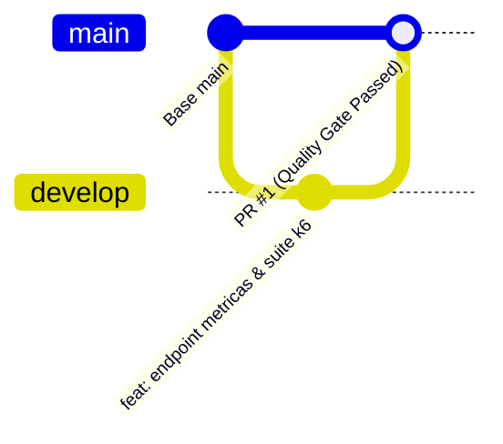

# Grafana k6: Laboratorio de Performance & Quality Gates en Microservicios

> **Curso:** Verificación y Validación de Software  
> **Tema:** Pruebas No Funcionales de Carga, Rendimiento y Estrés con Grafana k6  
> **Objetivo:** Comprender la detección de cuellos de botella arquitectónicos en microservicios, el establecimiento de Acuerdos de Nivel de Servicio (SLAs / Thresholds) y su automatización como barreras de calidad (Quality Gates) en pipelines de CI/CD.

---

## ¿Qué contiene este repositorio?

1. **`src/server.js`**: Microservicio simulado en Node.js/Express con comportamiento realista bajo concurrencia:
   - `GET /api/health`: Endpoint de caja negra ultra rápido (~5ms) para demostrar aislamiento de fallos.
   - `GET /api/ordenes`: Simulación de acceso a base de datos con contención progresiva en el pool de conexiones (nominal < 120ms, contención moderada 200-450ms, saturación crítica 600-2200ms con errores 500).
   - `POST /api/ordenes`: Creación transaccional con validación de esquema (400 vs 201).
2. **`tests/workshop/`**: Suite didáctica de pruebas comentadas línea por línea:
   - `01-smoke-test.js`: Verificación rápida de disponibilidad (5 VUs, 15s).
   - `02-load-test-sla.js`: Prueba de carga con stages y evaluación de SLAs (50 VUs, Quality Gate).
   - `03-stress-breaking-point.js`: Prueba de estrés hasta 200 VUs para encontrar el Punto de Ruptura y demostrar aislamiento por tags.
3. **`tests/lib/html-report.js`**: Helper para generación dual: consola clásica con colores + reporte visual HTML interactivo.
4. **`templates-equipos/`**: Plantillas listas para copiar a los microservicios de los demás equipos (CRUD completo, SLA Gates y escenarios Spike).
5. **`.github/workflows/ci.yml`**: Pipeline automatizado de GitHub Actions que evalúa los SLAs en cada Pull Request y sube los reportes HTML como artefactos.

---

## Guía de Instalación de Grafana k6 en el CLI

Grafana k6 es un binario nativo escrito en Go, ligero, sin dependencias pesadas de NodeJS o Java.

### Windows
Ejecuta en PowerShell o CMD con permisos de usuario:
```powershell
# Opción 1: Mediante Winget (Recomendada)
winget install k6 --source winget

# Opción 2: Mediante Chocolatey
choco install k6
```

### Linux (Ubuntu / Debian / WSL2)
```bash
sudo gpg -k
sudo gpg --no-default-keyring --keyring /usr/share/keyrings/k6-archive-keyring.gpg --keyserver hkp://keyserver.ubuntu.com:80 --recv-keys C5AD17C747E3415A3642D57D77C6C491D6AC1D69
echo "deb [signed-by=/usr/share/keyrings/k6-archive-keyring.gpg] https://dl.k6.io/deb stable main" | sudo tee /etc/apt/sources.list.d/k6.list
sudo apt-get update
sudo apt-get install k6
```

### macOS
```bash
brew install k6
```

### Verificación de Instalación
En cualquier terminal, ejecuta:
```bash
k6 version
```
*Deberías ver una salida similar a: `k6 v2.2.0 (o superior)`.*

---

## Generación de Reportes HTML en Local (2 Métodos)

### Método 1: Integrado en el Código (`tests/lib/html-report.js`)
Todos los scripts del taller incluyen la función `handleSummary()`. Al finalizar la prueba, k6 ejecuta automáticamente esta rutina para:
1. Mantener la tabla completa en la terminal (stdout con colores).
2. Generar un archivo HTML autocontenido (`reporte-smoke.html`, `reporte-load-sla.html`, `reporte-stress.html`).

No necesitas instalar paquetes NPM extras ni configuraciones adicionales; k6 descarga la librería ligera en memoria durante la ejecución.

### Método 2: Web Dashboard Nativo en Vivo + Exportación HTML
Grafana k6 incluye un servidor web integrado que genera gráficas en tiempo real y exporta un informe HTML completo al finalizar:

#### En Linux / macOS / WSL2 (Bash/Zsh):
```bash
K6_WEB_DASHBOARD=true K6_WEB_DASHBOARD_EXPORT=reporte-nativo.html k6 run tests/workshop/02-load-test-sla.js
```

#### En Windows (PowerShell):
```powershell
$env:K6_WEB_DASHBOARD="true"; $env:K6_WEB_DASHBOARD_EXPORT="reporte-nativo.html"; k6 run tests/workshop/02-load-test-sla.js
```

> **En Vivo:** Mientras la prueba se está ejecutando, abre tu navegador en **[http://127.0.0.1:5665](http://127.0.0.1:5665)** para ver las curvas de latencia, usuarios virtuales y tasa de peticiones en tiempo real.

---

## Guía del Mini Laboratorio (Paso a Paso en 20 Minutos)

### Paso 1: Instalar dependencias y levantar el microservicio
Abre una terminal en la raíz del proyecto:
```bash
npm install
npm start
```
*Verás el mensaje indicando que el servidor escucha en `http://localhost:3000`.*

---

### Paso 2: Smoke Test y Load Test con SLAs (Quality Gate)
Abre **otra terminal** (dejando la API corriendo) y ejecuta:

#### 1. Prueba de Humo (Smoke Test):
```bash
npm run test:smoke
```
*Valida que la API esté viva. Genera `reporte-smoke.html`.*

#### 2. Prueba de Carga con SLAs:
```bash
npm run test:load
```
*Genera `reporte-load-sla.html`.*

####  ¿Cómo interpretar la tabla de la terminal?
```text
✓ http_req_duration..............: avg=78.4ms  min=41.2ms med=73.5ms max=320.1ms p(90)=112.4ms p(95)=189.6ms
✓ http_req_failed................: 0.00%  ✓ 0  ✗ 1850
```
- **`http_req_duration p(95)`**: El percentil 95 indica que el 95% de las peticiones tardaron menos de ese valor. Si el SLA era `< 500ms` y el p(95) es `189.6ms`, la prueba muestra un tick verde `✓`.
- **`http_req_waiting`**: Tiempo que tardó el servidor en procesar y generar el primer byte (TTFB / Time To First Byte). Revela demoras internas de cómputo o base de datos.
- **`http_req_failed`**: Porcentaje de respuestas no exitosas (4xx o 5xx). Debe ser `< 1%`.

---

### Paso 3: El Experimento de los 200 Usuarios Virtuales (Punto de Ruptura)
Ejecuta la prueba de estrés:
```bash
npm run test:stress
```

####  ¿Qué sucede durante la prueba?
1. Al superar los 35 usuarios activos concurrentes, el pool de conexiones de la base de datos simulada en `src/server.js` se satura.
2. La latencia de `/api/ordenes` escala de 200ms a **más de 1800ms**.
3. En la terminal verás la alerta roja **`✗ http_req_duration{endpoint:ordenes_db}... p(95)<500`**, señalando el incumplimiento del Quality Gate.
4. **Técnica de Aislamiento de Caja Negra**: Observa que **`✓ http_req_duration{endpoint:health}`** se mantiene en verde (< 100ms). Esto demuestra a los estudiantes que el microservicio y el Event Loop de Node.js no están caídos; la falla está aislada en la capa de persistencia (Base de Datos).
5. Abre en tu navegador el archivo generado `reporte-stress.html` para visualizar la comparativa gráfica.

---

### Paso 4: Adopción en los Repositorios de cada Equipo
Los demás equipos pueden incorporar pruebas de rendimiento a sus propios microservicios en minutos:
1. Consulta la carpeta [`templates-equipos/`](templates-equipos/README-TEMPLATES.md).
2. Copia `templates-equipos/microservice-sla-gate.template.js` o `api-crud-flow.template.js` a tu repositorio.
3. Configura el archivo `.github/workflows/ci.yml` para que k6 evalúe la API antes de permitir fusionar cambios a `main`.

---

## Flujo de Trabajo con Pull Requests y Quality Gate en CI/CD

El repositorio está configurado siguiendo las mejores prácticas de GitFlow para la validación continua:



1. **Desarrollo en rama `develop`**:
   Las nuevas características, endpoints y optimizaciones se desarrollan en `develop`.
2. **Apertura de Pull Request hacia `main`**:
   Al enviar un PR de `develop` a `main`, GitHub Actions dispara automáticamente el job `performance-gate`.
3. **Validación Automática de SLAs**:
   - Si la prueba cumple `p(95) < 500ms` y `tasa de fallo < 1%`, el PR recibe el check verde `✓` permitiendo la fusión.
   - Si se introduce un cuello de botella arquitectónico que degrade el servicio, el Quality Gate falla y bloquea el merge.
4. **Descarga de Evidencias**:
   Los reportes gráficos `reporte-load-sla.html` y `dashboard-ci.html` se guardan automáticamente en la pestaña **Summary > Artifacts** del workflow.

---

## Enlaces Oficiales del Ecosistema Grafana k6

- [Documentación Oficial e Instalación de Grafana k6 OSS](https://grafana.com/docs/k6/latest/set-up/install-k6/)
- [Repositorio Oficial de k6 (Open Source en GitHub)](https://github.com/grafana/k6)
- [Grafana Cloud k6 (Plataforma SaaS y Free Tier)](https://grafana.com/products/cloud/k6/)
- [Grafana k6 Studio (Aplicación de escritorio para grabar scripts)](https://grafana.com/docs/k6-studio/latest/)
- [k6 Operator para pruebas distribuidas en Kubernetes](https://github.com/grafana/k6-operator)
- [k6 HTML Reporter (benc-uk/k6-reporter)](https://github.com/benc-uk/k6-reporter)